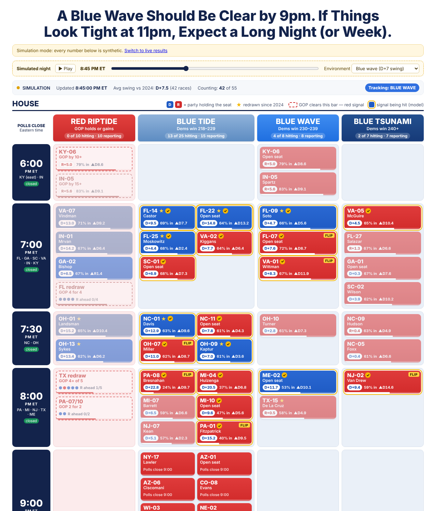

# Electoral Contraceptive: election-night House tracker

A live board for the 2026 House bellwether races, laid out like the "A Blue Wave Should Be Clear by 9pm"
graphic. It collects **precinct returns** as counties publish them and compares every precinct with **how
the same precinct voted in 2024**. That shows which way each district, county and state is moving before
races are called.



- **Board.** Rows are poll-closing times and columns are Red Riptide, Blue Tide, Blue Wave and Blue
  Tsunami. Cards are colored by the party holding the seat; ★ means redrawn since 2024; dashed red cards
  are "GOP clears this bar" signals. Each card shows the margin, % of expected vote in, and swing against
  2024. A gold ring means the card's signal is being hit, a faded card means it is being missed, and
  FLIP marks a projected flip. Column headers keep a running tally, and the top bar shows the average
  swing and which column the night is tracking toward.
- **Click any card** for the race detail: candidates, margin, swing, projected final margin with a range,
  turnout against 2024, a scatter plot of every precinct (2026 margin against 2024), a timeline, a
  breakdown by vote type, a county table, and a searchable, sortable table of every precinct. You can
  switch the baseline between **2024 President** and **2024 House**.
- **3D precinct map** (`map.html`, linked from the board): every precinct as a line standing on a
  rotatable US map. In **Who leads** mode, height is the share of the precinct's expected vote counted
  and color is who is ahead. **Shift since 2024** turns each line into a vector whose length is the
  swing against 2024; it leans west and blue for a Democratic shift, east and red for a Republican one.
  Switch between House and Senate races and between the 2024 President and House baselines. Drag to
  move, scroll or pinch to zoom, right-drag / Ctrl+drag (two-finger drag on phones) to rotate and tilt;
  the buttons at the bottom right do the same. Hover or tap a line for its numbers. Positions are
  approximate: results come by precinct and the 2024 files carry no coordinates, so each precinct is
  drawn at a fixed spot inside its county (county-level results stand at the county's center).
- **Simulation:** add `?demo` to the URL for a simulated night with a time slider and a national
  environment picker. Use it to check everything before polls close. It works on the map too
  (`map.html?demo`), where the simulated precincts are scattered across real counties.

## Setup (before polls close)

1. **Make the repo public** (Settings → General → Danger zone → Change visibility). GitHub Pages on a free
   plan needs it, and the board reads live results from `raw.githubusercontent.com`, which only serves
   public repos.
2. **Turn on Pages:** Settings → Pages → Build and deployment → Source: **GitHub Actions**. Then open
   Actions → *Deploy board to GitHub Pages* → **Run workflow**. The board will be at
   **https://jsherman999.github.io/electoral-contraceptive/**.
3. **Check the data path:** Actions → *Election night collector* → Run workflow with **demo** ticked.
   It publishes simulated results to the `election-data` branch. Within a minute or two the Pages board
   should show "TEST DATA (simulated)". If it does, the whole path works.
4. **Election night:** the collector starts by itself at **5:40 pm ET** and again at **11:30 pm ET**. Each
   run lasts about 5¾ hours, because a GitHub job is limited to 6 hours. You can also start it by hand. It
   collects every 90 seconds and force-pushes a single commit to `election-data`. The board refreshes
   about every 75 seconds.
   *Scheduled runs can start late when GitHub is busy. If nothing has started by about 5:50 pm ET, start
   it by hand.*

### Fallback: run it on your own machine

Node 18 or newer, no `npm install` needed:

```bash
npm run live                                   # collect every 90 s and serve http://localhost:8080
node collector/collect.js --watch --publish    # collect and push to election-data from your laptop
node collector/collect.js --once --only NC-01  # one pass for one race
node collector/collect.js --demo --serve       # simulated results through the whole pipeline
```

## Relaying Ohio and Michigan from your own computer

Some state sites refuse requests from GitHub's servers but answer a normal home connection. Ohio's
results XML returned 403 to GitHub on one run, and Michigan's site doesn't respond to GitHub at all.
`collector/relay.js` fetches those feeds from your computer and pushes the parsed results to an
`election-data-relay` branch. The GitHub collector reads that branch on every pass and uses it whenever
its own direct fetch fails, so the public board shows those races for everyone.

On a Mac (Node 18+: `brew install node`), from a clone you can push to:

```bash
git clone https://github.com/jsherman999/electoral-contraceptive && cd electoral-contraceptive
node collector/relay.js --feeds oh --once   # test: one Ohio pass, pushed to election-data-relay
caffeinate -i node collector/relay.js       # all night: Ohio every 90 s (caffeinate keeps the Mac awake)
caffeinate -i node collector/relay.js --feeds oh,sc,co   # also SC and CO, if your connection gets through
```

- Leave it running in a Terminal window. If it stops, relayed data is ignored after 15 minutes, and the
  board's Sources line says the relay stopped.
- If a site refuses your computer too, the relay says so and retries every 5 minutes. It doesn't try
  to get around the refusal.
- **Michigan statewide** can't be relayed. Its results site (mvic.sos.state.mi.us) returns 403 to
  scripts even from a home connection, and the old mielections.us site no longer answers. Some counties
  publish precinct results on Clarity, which can be relayed: **Macomb** (250 of MI-10's 288 precincts)
  is set up as feed `mi-macomb`, so add it with `--feeds oh,sc,co,ia,mi-macomb`.
- **South Carolina and Colorado** (Clarity) answer automated requests with a bot challenge, at least
  from GitHub. Check whether your connection gets plain data with
  `node collector/probe.js https://www.enr-scvotes.org/SC/127227/current_ver.txt https://results.enr.clarityelections.com/CO/127407/current_ver.txt`.
  If each prints a short number, add `sc,co` to `--feeds`.
- Run it on one computer only.

## Importing Michigan (or any state) by hand

Michigan's results site refuses scripts, but you can still use it in a browser. Download or copy the
results into a CSV, then:

```bash
node collector/manual.js --state MI --file ~/Downloads/mi-results.csv --dry-run   # check what it found
node collector/manual.js --state MI --file ~/Downloads/mi-results.csv             # push it
```

- The importer recognizes common column names (County, Contest/Office/OfficeDescription, District,
  Candidate or first/last name, Party, Votes/CandidateVotes, optional Precincts and Precincts
  Reporting). It lists which board races it found. If the site has no download, paste the numbers into
  a spreadsheet laid out like [`manual/template.csv`](manual/template.csv) and save it as CSV.
- It pushes to the same `election-data-relay` branch as the relay script. The board shows it within
  about 90 seconds, for everyone. Imported Michigan data is trusted for 12 hours, so re-import whenever
  you download fresh numbers.
- County-level House results are compared with 2024 only for counties wholly in the district. Include
  the Precincts columns if the download has them; without them, House races show margins only, while
  the Senate race is compared county by county.

## Adding feeds on election night

Most states publish their 2026 results URLs only on the night. Feeds live in
[`config/sources.json`](config/sources.json). Every race uses its state's feeds and finds its own contest
("auto" understands names such as *US HOUSE OF REPRESENTATIVES DISTRICT 01*, *Representative in Congress
7th District* and *Member, House of Representatives (2nd District)*, and skips state house races).

**Edit `config/sources.json` on GitHub (the pencil icon) and commit to `main`.** The running collector
pulls config on every pass, so a pasted URL starts working within about 90 seconds.

| Adapter | Use it for | What to paste |
|---|---|---|
| `ncsbe` | North Carolina (statewide, precinct level) | **Already set up and verified.** The 2026 file is live with zero counts. |
| `clarity` | SC, CO, IA statewide (**set up to find tonight's election by itself**); many county sites elsewhere (PA, MI, NJ, OH, KY, NE) | Nothing for SC/CO/IA: on each pass the collector scans the official results pages for links to the Clarity site and uses the newest election dated 11/3/2026. Status shows under **Sources**. To override, paste the results page URL from your browser, e.g. `https://www.enr-scvotes.org/SC/<id>/web.345435/#/summary`. Works on state-branded Clarity hosts too. Statewide pages fetch every county's precinct file; limit with `"counties": ["Charleston"]`. |
| `in-enr` | Indiana statewide, county level | Preset to `https://enr.indianavoters.in.gov/site/` (office category 1005 = US Representative). |
| `enhanced-voting` | Georgia and Virginia (both preset from their 2024 URL patterns) | The public results page, e.g. `https://results.sos.ga.gov/results/public/Georgia/elections/2026NovGen` |
| `fl-dos` | Florida statewide, county level | Preset. Add county Supervisor of Elections feeds for precinct detail; precinct rows replace the county row. |
| `delimited` | Any CSV/TSV (zipped or not) | URL plus a `columns` map (see [`collector/adapters/delimited.js`](collector/adapters/delimited.js)) |
| `json` | Any JSON API | URL plus `rowsPath` and a `fields` map (see [`collector/adapters/json.js`](collector/adapters/json.js)) |

Several feeds for one race (for example two county sites for NY-17):

```json
"feeds": {
  "rockland":    { "adapter": "clarity", "url": "https://results.enr.clarityelections.com/NY/Rockland/12345/..." },
  "westchester": { "adapter": "delimited", "url": "https://.../precincts.csv",
                   "columns": { "county": "County", "precinct": "Precinct", "contest": "Contest",
                                "candidate": "Candidate", "party": "Party", "votes": "Votes" } }
},
"races": { "NY-17": [ { "feed": "rockland" }, { "feed": "westchester" } ] }
```

Each feed's status (rows, errors, source timestamp) is shown under **Sources** in every race's detail
panel and in `summary.json`. A failing feed keeps its last good data.

**Race calls:** add `"NC-01": { "party": "D", "note": "AP 9:41 pm" }` to
[`config/calls.json`](config/calls.json). Called races show ✓ and count as final for the signals.

**Signals and layout:** [`site/board.json`](site/board.json) holds the cards, columns, thresholds
("GOP by 10+") and composite cards ("FL redraw GOP 4 for 4"). The FL and TX redraw member districts are
my best reading of the graphic, so check them.

## How the comparison works

- **Matching:** each 2026 precinct is joined to its 2024 precinct by county and normalized name. The
  normalization handles case, "Precinct"/"Pct" prefixes, leading zeros and code-only fallbacks. Match
  rates are shown per race. For NC, 96–99% of 2026 precincts match.
- **Like for like:** early and mail votes usually arrive first and lean Democratic, so comparing them with
  the full 2024 result would show a fake blue surge. Instead, each vote type (Election Day, early, mail,
  provisional) is compared only with the same type in the same precinct in 2024.
  `swing = margin(2026 cells counted) − margin(same cells in 2024)`.
- **Batches:** absentee, provisional and early-vote-site batches are merged per county and compared with
  the county's 2024 batches. When a county reported early votes by site in 2024 but reports them by
  precinct in 2026 (or the reverse), votes are moved between precincts and batches so both years cover
  the same ground. In counties split between districts, the 2024 batch is scaled by the district's share
  of each party's vote (shown as `batch~`).
- **Projection:** uncounted cells are filled with their 2024 votes, scaled by turnout so far and shifted
  by the swing so far, separately for each vote type. The range narrows as the counted share grows. This
  is a model estimate, **not a race call**.
- **Validation:** replaying NC's real 2024 precinct file through the collector as if it were live gives a
  swing of 0.0 against the 2024 House baseline for NC-01 and NC-11. The exception is split-county batches
  (Guilford), which are off by 1–2 points.

## Data sources

| | Source |
|---|---|
| 2024 baseline, NC | NC State Board of Elections, `results_pct_20241105.zip` (same precinct names as the 2026 file) |
| 2024 baseline, other 20 states | [MIT Election Data + Science Lab 2024 precinct returns](https://github.com/MEDSL/2024-elections-official). Statewide presidential totals in the built files match the official results. |
| 2026 live | See the table above. Rebuild baselines with `npm run baseline`. |

## Known limits

- Only NC is wired to a verified live feed. SC, CO and IA find their results URL automatically on the
  night. FL, GA and VA are preset to URL patterns that could not be tested from here. Other states need
  a URL pasted. Races without a feed show "No feed yet".
- Precinct boundaries and names change between elections. Unmatched precincts count toward totals but
  not toward swing. Treat a match rate under about 70% with caution.
- County-level feeds (Florida's state file) compare a county only once all its precincts are in.
- In split counties, 2024 batches (`batch~`) are an estimate.
- The board polls GitHub's API once per refresh (60 requests per hour without logging in). If that runs
  out, it reads the branch through the CDN, which can lag up to about 5 minutes.

## Layout

```
site/                 static app (GitHub Pages)
  board.json          cards, columns, signals, composites
  map.html, js/map.js 3D precinct map (deck.gl 9.4.0, vendored in site/vendor/)
  geo/us-map.json     state outlines and county shapes (us-atlas / Census; rebuild with collector/build-map-geo.js)
  js/shared/          model, normalization and simulator, shared by the browser and the collector
collector/            Node collector (no dependencies)
  adapters/           ncsbe, clarity, enhanced-voting, fl-dos, in-enr, tx-civix, cdf, delimited, json, relay
  build-baseline.js   builds baseline/<st>.json.gz
config/               sources.json (feeds) and calls.json (manual calls)
baseline/             2024 precinct baselines (President and House, by vote type) for 21 states
test/                 npm test
.github/workflows/    pages.yml (deploy board) and election-night.yml (collector loop)
```

See [PLAN.md](PLAN.md) for the original design.
